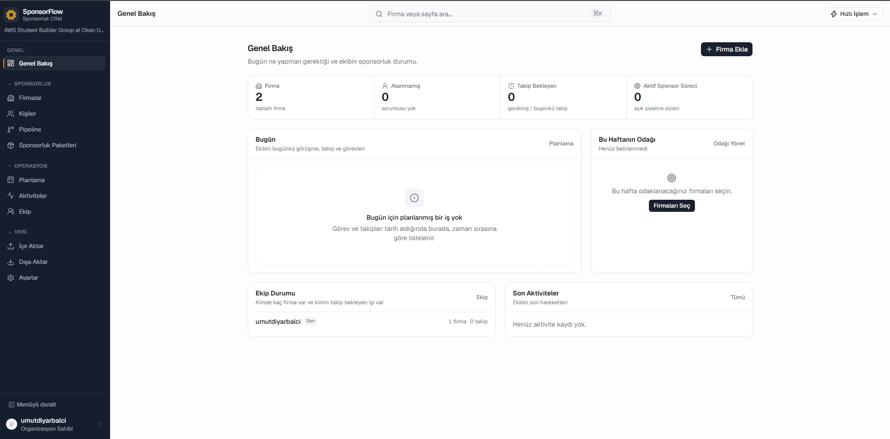

# SponsorFlow

I built SponsorFlow for the AWS Student Builder Group at Okan University to help student teams track sponsorship conversations and hand them over when committee members change. Each company record brings together the team member responsible, the contact history, and the next follow-up.

## 📸 Screenshots

| Team sign-in | Sponsorship dashboard |
| --- | --- |
| [](docs/screenshots/login.png) | [](docs/screenshots/dashboard.png) |

## ⚙️ Features

- **Company handovers.** Assign companies to team members and keep contacts, meeting notes, and messages with the company record. When a member leaves, their companies return to the unassigned list.
- **Sponsorship pipeline.** Move opportunities across six stages, record the next action, and track successful and unsuccessful outcomes. Reusable sponsorship packages keep offers consistent.
- **Weekly planning.** Select priority companies for the week, schedule follow-ups in the planner, and review each company's outreach, replies, and meetings from its activity log.
- **Team access.** Role-based permissions control who can view records, update sponsorship work, and manage members.
- **Spreadsheet import and export.** Import company lists from CSV or Excel with column mapping, validation, and duplicate checks. Export company, contact, and opportunity records for reporting or handover.

## 🛠️ Technologies

| Layer | Technologies |
| --- | --- |
| Application | Next.js 16 App Router, React 19, TypeScript |
| Data and authentication | PostgreSQL, Prisma 7, Supabase Auth |
| Interface | Tailwind CSS 4, Radix UI, dnd-kit |
| End-to-end tests | Playwright |

## 💻 Running locally

Use pnpm and a Supabase development project with PostgreSQL and email/password authentication.

```bash
git clone https://github.com/umutdiyar/sponsorflow.git
cd sponsorflow
cp .env.example .env
```

Fill in the Supabase credentials and both database connection strings in `.env`. Set `NEXT_PUBLIC_APP_URL` to `http://localhost:3000`. The [setup guide (Turkish)](docs/setup.md) describes each variable and the first-account setup.

```bash
pnpm install
pnpm db:deploy
pnpm db:seed
pnpm dev
```

Create a confirmed test user in Supabase Authentication, then sign in at [localhost:3000](http://localhost:3000). The seed creates the organization and pipeline stages. The first sign-in provisions the initial owner's membership.

For sample companies, contacts, opportunities, and tasks, run `pnpm fixture` in a second terminal **after the first sign-in**, using a development database.

## 🧪 Development checks

Run `pnpm lint` and `pnpm typecheck` for static checks, and `pnpm build` for a production build. The [Playwright guide](e2e/README.md) covers setup for the end-to-end smoke tests.
